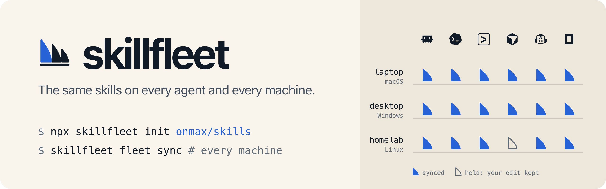

<h1>
  <picture>
    <source media="(prefers-color-scheme: dark)" srcset="https://raw.githubusercontent.com/onmax/fleetrc/main/.github/assets/banner-dark.svg">
    <source media="(prefers-color-scheme: light)" srcset="https://raw.githubusercontent.com/onmax/fleetrc/main/.github/assets/banner-light.svg">
    
  </picture>
</h1>

[](https://www.npmjs.com/package/fleetrc)
[](https://www.npmjs.com/package/fleetrc)
[](https://github.com/onmax/fleetrc/actions/workflows/release.yaml)
[](#status)
[](https://github.com/onmax/fleetrc/blob/main/LICENSE)

One config for your agent skills across Claude Code, Codex, Gemini CLI, OpenCode, Cursor and GitHub Copilot, synced on every machine when an agent session starts. It also syncs user-level instruction files, subagents, commands, MCP servers and agent hooks.

## Set up with your agent

Copy this prompt into Claude Code, Codex or another agent. The agent looks at your current setup and asks you what it can't find out. It shows what will go into Git before pushing, then previews the local changes before running `init`.

```md
Set up fleetrc (https://github.com/onmax/fleetrc) on this machine. fleetrc keeps one config in a git repository and links my skills, instruction files, subagents, commands, MCP servers and agent hooks into every agent I use, on every machine.

1. Read https://github.com/onmax/fleetrc#readme. Check that Node.js is 22.12 or newer and that git is installed. `gh` is optional for finding, creating and cloning my GitHub repo.
2. If the official `fleetrc` npm package and its schema are available, use `npx fleetrc@<version>` and read `https://unpkg.com/fleetrc@<version>/schema.json` with that same version. If there's no usable release, ask before building from source: in a separate checkout of https://github.com/onmax/fleetrc, use the pnpm version in its package.json, run `pnpm install --frozen-lockfile --ignore-scripts` and `pnpm build`, and use `node <absolute-path-to-checkout>/dist/cli.mjs` instead of `npx fleetrc` below. Read `schema.json` from that same checkout. Use only the fields your schema defines.
3. Look at what I have now, and change nothing yet:
   - Run `npx fleetrc agents` (using the CLI chosen in step 2) to see my installed agents and the folders each one reads.
   - List the skills in those folders (a skill is a folder with a SKILL.md), and note which are links and where they point.
   - Find my user-level instruction files (such as ~/.claude/CLAUDE.md and ~/.codex/AGENTS.md), subagents (~/.claude/agents), commands (~/.claude/commands) and MCP servers (~/.claude.json, ~/.codex/config.toml).
   - If `gh` is available and signed in, list my GitHub repositories that hold skills, dotfiles or agent config.
4. Show me what you found, then ask me, in one message, everything you still need:
   - Which repository holds the config: one of mine, or a new private one you create? Where should its working clone live on this machine?
   - Which of my current skills, instruction files, subagents, commands and MCP servers go into it?
   - Which other skills to add: any GitHub repository (all of its skills, or only some), an npm package, or a site that serves /.well-known/agent-skills/index.json? Should their updates wait for my review?
   - Is there a team config to extend?
   - Should every installed agent get them, or only some?
   - Should other machines sync too, as SSH hosts or Tailscale tags? Which servers have no agent and need the timer?
5. Wait for my answers. In the working clone, write .fleetrc/manifest.json and copy only the selected hand-made skill folders and instruction files, subagents and commands. Keep the originals in place for now.
   - Use a git source for those files, with `path` pointing to the working clone (prefer a portable `~/…` path) and globs or per-agent mappings for the selected files. Leave `adopt` off: it can move unselected skills even if you set `include`.
   - For the selected MCP servers, write a separate file for the `mcp` source field and use ${VAR} placeholders, never secret values. Do not copy whole agent config files.
   - Show me the exact files and destination repository before pushing. Check the staged diff for secrets and unrelated changes, then commit and push only the approved files. Make sure the manifest and files are reachable from the repository ref you'll pass to `init`.
6. Run `npx fleetrc init <repository> --dry-run --json`. Both previews in this step must exit successfully, contain `sync.ok: true` and have an empty `sync.errors` list. Review the migrations, warnings, and additions, updates and removals in `sync.files` and `sync.entries`. File replacements can be missing from the change arrays: for each planned destination in `sync.files.links`, use the manifest and source mapping to compare the existing link target with the planned target. Show me the destination and old and new targets for each relink, the other changes and any conflicts, without displaying secrets. Stop if you can't establish that unselected items will be left alone.
   - Include any manual steps in the approval plan: clearing occupied destinations for selected files and removing selected same-name MCP entries in `sync.entries.foreign` or `sync.entries.held`. Neither status proves a replacement is available. Before removing anything, confirm the intended source definition can be translated for that agent and that its variables resolve in the agent's launch environment. Leave the original in place if source or translation warnings prevent the replacement, or if you can't confirm it. Name each original path, MCP entry name where applicable, and private local backup path outside the repo and agent folders.
   - After I approve, move only the approved file conflicts to their backups. Back up affected MCP configs privately, then remove only the approved conflicting server entries in place, preserving all other servers and settings. Rerun the JSON preview and repeat the checks, including the link comparison and the expected additions at cleared destinations. If a check fails, an expected addition is missing, or the plan differs from what I approved, undo the manual changes and stop. Restore only the entries you removed, not whole config files, and do not overwrite newer changes.
   - Otherwise run the same `init` command without `--dry-run`, keeping `--json`. Check the exit status and the applied `sync` report for errors, warnings and skipped writes (`sync.entries.skipped`). Keep the backups. Verify each selected skill and file is managed at its destination and each selected MCP server matches the intended definition in the live agent config, without printing secrets. Use `npx fleetrc list` to check ownership, not as proof of a live entry. Report failed, skipped or missing replacements as incomplete, restore missing originals from the backups without overwriting unrelated settings or newer changes, and ask before continuing.
7. Run `npx fleetrc doctor` and tell me the result. If I use Codex, tell me to open /hooks once to approve the hook. If I named other machines, offer to run `npx fleetrc fleet init <host-or-tag>` for each, adding `--timer` only where I asked for it. If using the source build, remote enrollment also needs an installable package: use `FLEETRC_PACKAGE` with an approved tarball URL the hosts can reach, or defer remote enrollment until a release is available.
```

[Watch or download the explainer (MP4)](.github/assets/explainer.mp4)

https://github.com/user-attachments/assets/d51e096f-9e02-49c3-85d4-9986b0aa1169

- **One copy per skill.** fleetrc fetches `git`, `npm`, `index` and `local` sources and links each skill into every installed agent's folder.
- **Session-start syncs.** `init` installs `SessionStart` hooks in Claude Code and Codex that start a background sync when none has been tried in the last 15 minutes. Servers without an agent use `--timer`.
- **Safe edits and reviews.** Upstream changes wait for `diff` and `merge` when you edit a skill locally. `"update": "review"` holds later changes until you run `fleetrc update`; the first fetch links skills immediately, so review third-party sources before adding them.
- **Shared team configs.** `"extends"` inherits sources from a team repo while ignoring `hooks`, `report`, `fleet`, `path`, `local`, `mcp` and `agentHooks`, so a team config cannot run commands on your machine.

## Install

Requires Node.js 22.12 or newer, plus `git` for git sources.

```sh
npx fleetrc init my-team/agents
```

The argument can be a repository like `owner/repo`, `github:owner/repo`, `gitlab:group/repo` or a `.git` URL, which fleetrc reads for `.fleetrc/manifest.json`. It can also be a file in a repository like `github:my-team/agents//team.json`, or a local file or folder such as `init .`.

`init` copies fleetrc into `~/.local/state/fleetrc`, or `%LOCALAPPDATA%\fleetrc` on Windows, links `fleetrc` into `~/.local/bin` when it is on `PATH`, migrates existing skills, and installs the session hooks. Pass `--dry-run` first to preview the migration. In Codex, open `/hooks` once to approve the hook.

## Quick start

### Write your config

Your config is `.fleetrc/manifest.json` in a git repository, usually the one that holds your own skills:

```json
{
  "$schema": "https://unpkg.com/fleetrc/schema.json",
  "extends": ["my-team/agents"],
  "sources": [
    {
      "id": "mine",
      "git": "me/skills",
      "path": "~/code/skills",
      "skills": "skills/*",
      "adopt": true
    },
    { "id": "nuxt", "git": "onmax/nuxt-skills", "include": ["nuxt", "nuxt-ui"] },
    { "id": "ag-grid", "git": "ag-grid/skills", "update": "review" }
  ],
  "fleet": ["laptop", "tag:servers"]
}
```

Then run `npx fleetrc init me/skills` on each machine. When two sources have a skill with the same name, the first one wins, and your `sources` come before the ones from `extends`.

### Add a machine

From a machine that is already set up, initialize another over SSH and add it to `fleet`:

```sh
fleetrc fleet init vps2          # or tag:servers on Tailscale; add --timer for a headless server
```

If fleetrc prints an entry to add instead of editing a working clone, add it to `fleet` in the manifest. Commit and push any enrollment change, then refresh the manifest on the controller before syncing the fleet:

```sh
fleetrc sync
fleetrc fleet sync
```

The config must live in a git repository, and the remote host needs Node.js 22.12 or newer.

### Take the config from your tailnet

On Tailscale, set the config once in your tailnet policy's `nodeAttrs`:

```jsonc
"nodeAttrs": [
  { "target": ["*"], "app": { "github.com/onmax/fleetrc": [{ "manifest": "me/skills" }] } }
]
```

Then run `npx fleetrc init` on a fresh machine or one already following the policy. To switch an existing machine from its own manifest, run `npx fleetrc init tailscale:`; bare `init` keeps its current manifest. Only follow a tailnet policy whose editors you trust, because the root config can run local commands through `hooks`, `report`, `mcp` and `agentHooks`.

## Commands

Run `fleetrc <command> --help` for full options. Most commands accept `--dry-run`, `--json`, `--offline`, `--copy`, `--no-copy` and `--manifest <m>`.

| Command                                            | What it does                                                                                                                                      |
| -------------------------------------------------- | ------------------------------------------------------------------------------------------------------------------------------------------------- |
| `sync [source]`                                    | Fetch all sources, or only `source`, and link skills. Plain `fleetrc` runs this.                                                                  |
| `init [manifest]`                                  | Point this machine at a config, migrate folders, sync, and install the CLI and session hooks. Accepts `--no-hooks`, `--timer`, `--force`.         |
| `status`                                           | Show the last run, held or pending updates, edited skills and sessions to restart.                                                                |
| `list`                                             | List linked skills, files and config entries. `list --json` reads local state only, with no network.                                              |
| `agents`                                           | List every agent id, which ones are installed here, and where each reads skills and files.                                                        |
| `doctor`                                           | Check Node.js, git access, session hooks or timer, and duplicate skills.                                                                          |
| `add <source>`                                     | Add `owner/repo`, a git or index URL, `npm:<package>` or a local path and sync. Accepts `--id`, `--skills`, `--include`, `--exclude`, `--review`. |
| `remove <source\|skill>`                           | Remove a source, or exclude a skill from its source or `extends` entry.                                                                           |
| `adopt <path>`                                     | Move a hand-made skill folder into your `"adopt": true` working clone.                                                                            |
| `fork <skill>`                                     | Copy a git source's skill into your personal repo and record it under `forks`.                                                                    |
| `diff [skill]`                                     | Show held updates, local edits, or an MCP server diff with `mcp/<agent>/<server>`.                                                                |
| `merge <skill>`                                    | Merge an upstream update into an edited skill or a fork.                                                                                          |
| `update <source>`                                  | Apply updates held by an `"update": "review"` source.                                                                                             |
| `timer install\|remove\|status`                    | Install, remove or check the scheduled sync timer.                                                                                                |
| `fleet sync\|status\|upgrade\|init\|add [host...]` | Sync, inspect, upgrade or set up SSH hosts and Tailscale `tag:<name>` peers. Accepts `--timeout <s>`.                                             |
| `hook install\|remove [agent]`                     | Add or remove session-start hooks for `claude-code` or `codex`.                                                                                   |
| `self-install`                                     | Copy this fleetrc into the state folder. `init` and `fleet upgrade` run it.                                                                       |

## Config reference

See [`schema.json`](./schema.json) for every field, type and constraint.

| Field                                               | Purpose                                                                                                                                                                                                                                                                        |
| --------------------------------------------------- | ------------------------------------------------------------------------------------------------------------------------------------------------------------------------------------------------------------------------------------------------------------------------------ |
| `extends`                                           | Team manifests to inherit sources from. Use `{ "manifest": "...", "exclude": [...], "excludeSources": [...] }` to drop items.                                                                                                                                                  |
| `agents`                                            | `"all"` by default for every installed agent, or a list of ids from `fleetrc agents`.                                                                                                                                                                                          |
| `sources[]`                                         | `git` (with `ref`, `path`, `adopt`, `followLinks`), `index` (`/.well-known/agent-skills/index.json` or v0.1), `npm` (with `registry`), or `local`. Common fields: `id`, `skills`, `include`, `exclude`, `update` (`"auto"` or `"review"`).                                     |
| `sources[].instructions`, `subagents`, `commands`   | Globs or per-agent maps for user-level instruction files, subagents and commands. Files are linked verbatim.                                                                                                                                                                   |
| `sources[].mcp`                                     | Path to a Claude Code-format `{"mcpServers": {...}}` file translated into each agent's config. Secrets must use `${VAR}`. Root config only.                                                                                                                                    |
| `sources[].agentHooks`                              | Path for Claude Code or per-agent map of hook files in each agent's native format. Root config only.                                                                                                                                                                           |
| `fleet`, `timer`, `hooks`, `report`, `hub`, `forks` | SSH or Tailscale hosts, cron schedule (`*/30 * * * *` default), shell commands to run when a source's files change (`FLEETRC_CHANGED`, JSON report on stdin), a command (`report.run`) and a URL (`hub`) that receive each run's report, and the forks `fleetrc fork` records. |

## Supported agents

Skills link into Claude Code, Codex, Gemini CLI, OpenCode, Cursor, GitHub Copilot and the rest of the agents in Vercel's [`skills`](https://github.com/vercel-labs/skills) package. Universal agents that read `~/.agents/skills` share that folder so skills are not duplicated.

Instruction files, subagents, commands, MCP servers and agent hooks sync into Claude Code, Codex, Grok, Gemini CLI, OpenCode, Cursor and GitHub Copilot wherever each agent supports user-level config. Run `fleetrc agents` to see every id and path on your machine.

Works on Linux with systemd, macOS with launchd, and Windows with Task Scheduler and junctions or `--copy`.

## Status

fleetrc is at 0.1.0, so expect changes before 1.0. `hub` currently receives sync reports only.

**Moving from skillfleet.** The first `fleetrc` command that changes anything moves an existing `skillfleet` install, and `fleetrc fleet upgrade` moves every host in `fleet`. For one release fleetrc still reads `.skillfleet/manifest.json`, the `github.com/onmax/skillfleet` tailnet capability and `SKILLFLEET_*` hook variables, with a warning. Rename them before the next release.

**Develop.** Run `pnpm install` and `pnpm ready` to format, build, check and test.

## License

[MIT](https://github.com/onmax/fleetrc/blob/main/LICENSE)
